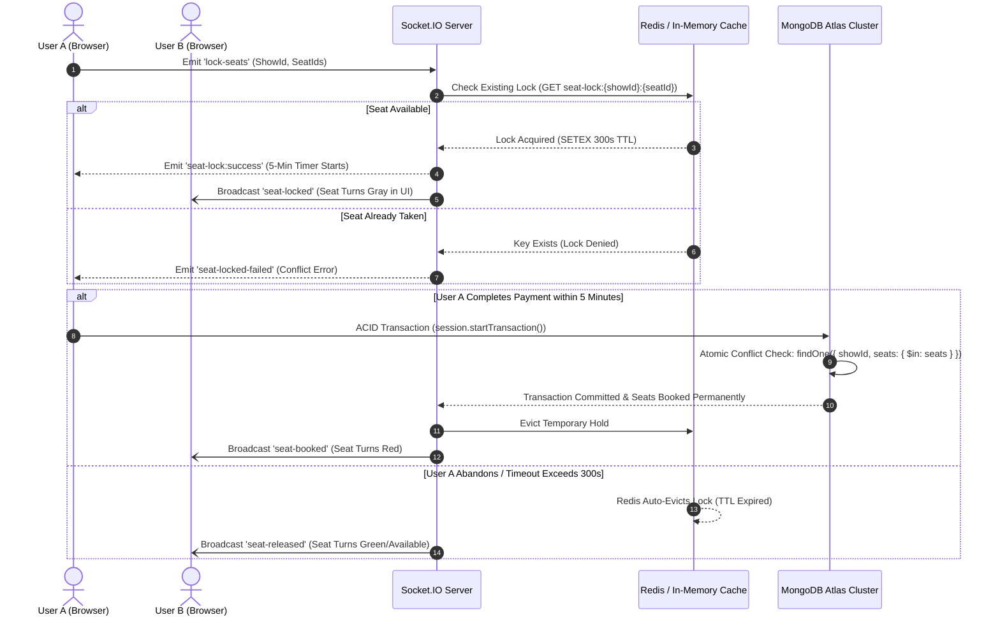

# 🎟️ RESERVEX — Real-Time Movie Ticket Booking Platform

[](https://reservex-client.onrender.com)
[](https://reservex-mkzs.onrender.com)
[](https://react.dev/)
[](https://www.typescriptlang.org/)
[](https://nodejs.org/)
[](https://www.mongodb.com/)
[](https://redis.io/)
[](https://socket.io/)

> **RESERVEX** is a production-ready, full-stack movie ticketing platform engineered to tackle high-concurrency seat reservation, distributed locking, and seamless real-time user experiences.

---

## 🚀 Live Links

* 🌐 **Live Web Application:** [https://reservex-client.onrender.com](https://reservex-client.onrender.com)
* 📡 **Live Backend API:** [https://reservex-mkzs.onrender.com](https://reservex-mkzs.onrender.com)
* 💻 **GitHub Repository:** [https://github.com/Aviral-shah/ReserveX](https://github.com/Aviral-shah/ReserveX)

---

## ✨ Key Features

* **⚡ Real-Time Seat Synchronization:** Interactive seating layout with bidirectional WebSocket updates via Socket.IO—selected seats instantly turn gray across all active browser sessions.
* **🛡️ Zero Double-Booking Guarantee:** Two-tier concurrency control featuring **Redis 5-minute TTL locks** and **MongoDB Multi-Document ACID Transactions**.
* **💳 Secure Payment Gateway:** Integrated Razorpay checkout with backend **HMAC-SHA256 cryptographic signature verification**.
* **📧 High-Speed Transactional Emails:** OTP authentication powered by **Resend HTTPS REST API** (Port 443) with responsive branded HTML templates and smart dev fallback.
* **🏙️ Multi-City & Multi-Theater Hierarchy:** Browse movies by location, filter by language/genre, and select showtimes across 68+ simulated multiplexes (PVR, INOX, Cinepolis).
* **🔐 Dual-Token Authentication:** Stateless security architecture utilizing short-lived Access JWTs and long-lived Refresh JWTs stored in secure `HTTP-Only`, `SameSite=None` cookies.
* **📱 Responsive Cinematic UI:** Modern cinema dashboard with Tailwind CSS, touch-friendly movie carousels, seat tier categorization (Platinum, Gold, Silver), and ticket booking history.

---

## 🏛️ System Architecture & Concurrency Design

### Double-Booking Prevention Sequence



### Two-Tier Concurrency Model:
1. **Tier 1 (Presentation / Hold Phase):**
   * Upon seat selection, the backend writes a lease to Redis: `SETEX seat-lock:{showId}:{seatId} 300 {userId}`.
   * If the user abandons checkout or loses network connectivity, Redis automatically frees the seat after 5 minutes without needing background cleanup workers.
2. **Tier 2 (Persistence / ACID Finalization Phase):**
   * During checkout, ticket creation and seat status updates execute within a **MongoDB Replica Set Transaction** (`session.startTransaction()`).
   * An atomic verification query (`BookingModel.findOne({ showId, status: "CONFIRMED", seats: { $in: seats } })`) guarantees that even under simultaneous API hits, no conflicting booking is ever written to disk.

---

## 🛠️ Tech Stack

| Domain | Technologies |
| :--- | :--- |
| **Frontend** | React 19, Vite, Tailwind CSS, React Router v7, TanStack React Query, Axios |
| **Backend** | Node.js, Express.js v5, TypeScript |
| **Database** | MongoDB Atlas (Replica Set Cluster), Mongoose ODM |
| **Real-Time & Caching** | Socket.IO, Redis (ioredis) with In-Memory Resilience Fallback Proxy |
| **Security & Auth** | JSON Web Tokens (JWT), Crypto (HMAC SHA-256), Cookie-Parser |
| **Payments** | Razorpay Node.js SDK |
| **Transactional Email** | Resend HTTPS REST API, Nodemailer (Port 465 SSL), Mailgen |
| **DevOps & Cloud** | Render (Web Service & Static Site), Git, GitHub |

---

## 📁 Repository Structure

```text
ReserveX/
├── client/                     # Frontend Application (React + Vite)
│   ├── public/                 # Static public assets
│   ├── src/
│   │   ├── apis/               # Axios client & API endpoints
│   │   ├── assets/             # Branding icons & movie assets
│   │   ├── components/         # Shared UI, Auth, Seat Layout, Movie Cards
│   │   ├── context/            # AuthContext, LocationContext, SeatContext
│   │   ├── hooks/              # Custom React hooks (useLoadUser, useCountdown)
│   │   ├── pages/              # Home, Movies, MovieDetails, SeatLayout, Checkout, Profile
│   │   ├── utils/              # Socket.io client setup & constants
│   │   └── App.jsx             # Route definitions & layout wrappers
│   ├── index.html              # HTML entry point with metadata
│   ├── package.json            # Client dependencies
│   └── vite.config.js          # Vite build configuration
│
├── server/                     # Backend API (Node.js + TypeScript)
│   ├── src/
│   │   ├── config/             # Environment, Database, Redis config & fallback
│   │   ├── middlewares/        # JWT auth, validation, and global error handlers
│   │   ├── modules/
│   │   │   ├── auth/           # OTP generation, hashing, JWT token service
│   │   │   ├── booking/        # ACID transaction booking service & controller
│   │   │   ├── movie/          # Movie catalog service & controller
│   │   │   ├── payment/        # Razorpay order generation & signature validation
│   │   │   ├── show/           # Showtime management & seat mapping
│   │   │   ├── theater/        # Multiplex locations & layouts
│   │   │   └── user/           # User profile & activation service
│   │   ├── routes/             # Centralized Express route aggregators
│   │   ├── scripts/            # Database seed scripts (movies, theaters, shows)
│   │   ├── socket/             # Socket.io real-time seat lock event handlers
│   │   └── server.ts           # HTTP & WebSocket server bootstrap
│   ├── package.json            # Server dependencies & build scripts
│   └── tsconfig.json           # TypeScript compiler configuration
│
└── render.yaml                 # Infrastructure as Code (Render Blueprint)
```

---

## ⚙️ Local Development Setup

### Prerequisites
* **Node.js** (v18 or higher)
* **npm** or **yarn**
* **MongoDB Atlas URI** (with Replica Set support for transactions)
* **Redis** (optional; the server includes an automatic in-memory fallback)

---

### 1. Clone the Repository
```bash
git clone https://github.com/Aviral-shah/ReserveX.git
cd ReserveX
```

---

### 2. Configure Environment Variables

#### **Backend (`server/.env`)**
Create `server/.env` with the following variables:
```env
PORT=9000
MONGO_CONNECTION_STRING=your_mongodb_atlas_connection_string
MONGO_REPLICA_STRING=your_mongodb_atlas_connection_string
HASH_SECRET=your_hashing_secret_key
ACCESS_TOKEN_SECRET=your_jwt_access_secret
REFRESH_TOKEN_SECRET=your_jwt_refresh_secret
FRONTEND_URL=http://localhost:5173
REDIS_HOST=127.0.0.1
REDIS_PORT=6379
RAZORPAY_API_KEY=your_razorpay_key_id
RAZORPAY_SECRET_KEY=your_razorpay_key_secret
RESEND_API_KEY=your_resend_api_key
```

#### **Frontend (`client/.env`)**
Create `client/.env` with the following variables:
```env
VITE_BACKEND_URL=http://localhost:9000/api/v1
VITE_SOCKET_URL=http://localhost:9000
VITE_RAZORPAY_API_KEY=your_razorpay_key_id
```

---

### 3. Install Dependencies & Seed Data

```bash
# Install backend dependencies
cd server
npm install

# Seed initial movies, theaters, and shows (Run once)
npm run seed:theaters
npm run seed:movies
npm run seed:shows

# Install frontend dependencies
cd ../client
npm install
```

---

### 4. Run the Application

Always start the backend server first:

```bash
# Terminal 1: Start Backend Server (runs on http://localhost:9000)
cd server
npm run dev

# Terminal 2: Start Frontend Client (runs on http://localhost:5173)
cd client
npm run dev
```

Open [http://localhost:5173](http://localhost:5173) in your browser.

---

## 📡 API Reference Overview

| Method | Endpoint | Description | Auth Required |
| :--- | :--- | :--- | :---: |
| `POST` | `/api/v1/auth/send-otp` | Generate & dispatch OTP via Resend | No |
| `POST` | `/api/v1/auth/verify-otp` | Verify OTP hash & issue JWT cookies | No |
| `POST` | `/api/v1/auth/logout` | Clear cross-site auth cookies | Yes |
| `GET` | `/api/v1/users/me` | Fetch authenticated user profile | Yes |
| `GET` | `/api/v1/movies` | Get all listed movies | No |
| `GET` | `/api/v1/movies/recommended` | Get featured movie banners | No |
| `GET` | `/api/v1/shows` | Query shows by Movie, State, and Date | No |
| `POST` | `/api/v1/payment/create-order` | Create Razorpay order ID | Yes |
| `POST` | `/api/v1/payment/verify-payment` | Verify HMAC-SHA256 signature | Yes |
| `POST` | `/api/v1/book` | Execute ACID transaction booking | Yes |
| `GET` | `/api/v1/book` | Retrieve user booking history | Yes |

---

## 📈 Scalability Roadmap (10M+ Users)

To scale RESERVEX to handle nationwide peak ticket drops (e.g. *Coldplay* or *Avengers*):
* **Distributed Locking at Scale:** Migrate single-instance Redis to a Redis Cluster using the **Redlock Algorithm** for multi-master consensus.
* **Socket.IO Cross-Node Pub/Sub:** Attach `@socket.io/redis-adapter` across horizontally scaled Node.js clusters to synchronize seat locks across different server instances.
* **Asynchronous Message Ingestion:** Introduce an **Apache Kafka / RabbitMQ** partition queue to buffer high-velocity payment webhooks and prevent write contention on MongoDB.
* **Database Sharding:** Shard the `Shows` and `Bookings` collections on MongoDB using compound keys (`state` + `theaterId`).

---

## 👤 Author

**Aviral Shah**
* GitHub: [@Aviral-shah](https://github.com/Aviral-shah)
* Project: [RESERVEX on Render](https://reservex-client.onrender.com)

---

## 📄 License
This project is licensed under the [ISC License](LICENSE).
